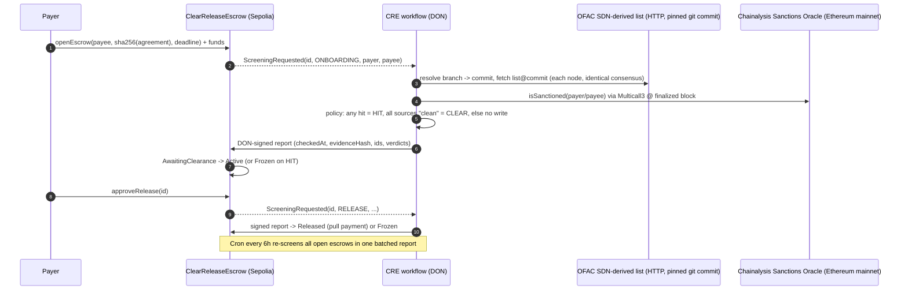

# ClearRelease: sanctions-gated legal escrow on Chainlink CRE

**Demo video:** https://youtu.be/ADreAkAUOoA · **Live contract (Sepolia):** [0x2FFE6Ec3…dc54f50](https://sepolia.etherscan.io/address/0x2FFE6Ec34D1470198ba64c1A88F5FBef0dc54f50)

**ClearRelease is an escrow for legal agreements where funds only move after sanctions screening.**
A Chainlink Runtime Environment (CRE) workflow screens both parties against two independent
sources. It screens them at signature, at the moment of payment, and periodically while the
escrow is open. A DON-signed report then releases, activates or freezes the escrow on-chain,
together with an evidence hash an auditor can recompute.

> Built for the **BLI Legal Tech Hackathon 2**, track *LegalTech & RegTech*, and the Chainlink
> bounty *Best workflow with CRE*.

---

## The problem

Escrow agents, law firms and marketplaces that pay out in crypto must not make funds available to
sanctioned persons. U.S. persons face strict civil liability under OFAC rules. Two practical gaps
remain in most crypto payment flows:

1. **Screening happens once, at onboarding.** Designations happen later. A counterparty that was
   clean when the contract was signed can be on the SDN list when the money moves.
2. **Teams rely on a single source.** The most common on-chain check is the Chainalysis Sanctions
   Oracle. We measured it against the official list:

| Measured 2026-10-16 (Ethereum block 26,203,837) | Count |
|---|---|
| ETH addresses listed in OFAC's SDN list (`Digital Currency Address - ETH`) | **120** |
| ...flagged by the Chainalysis on-chain oracle (`isSanctioned`) | 78 |
| ...**not** flagged by the oracle | **42 (35%)** |

All 42 missing addresses appear in OFAC's official `SDN_ADVANCED.XML` (verified against the file downloaded from OFAC on the same day).
You can reproduce the numbers with `bun run scripts/compare-sources.ts`; the full output is in
[`docs/source-comparison.json`](docs/source-comparison.json). An escrow that trusts only the
oracle would pay 42 sanctioned addresses without noticing.

ClearRelease screens **at every money-moving step**. It **combines sources under DON consensus**
and **fails closed**: no answer means no payment.

## How it works



### Workflow handlers (`screening-workflow/workflow.ts`)

| # | Trigger | What it does | Writes on-chain |
|---|---|---|---|
| 0 | **HTTP trigger** | Ad-hoc screening for up to 20 addresses. A law firm's case-management system can ask "may I pay these wallets?" and gets back an evidence record. | No |
| 1 | **EVM log trigger** on `ScreeningRequested` | Screens payer and payee for onboarding, release or review, then sends one signed report | Yes |
| 2 | **Cron** (`0 0 */6 * * *`) | Re-screens every open escrow and catches designations made after onboarding. Sends one batched report | Yes |

### CRE capabilities used

| Capability | Use |
|---|---|
| HTTP client + `consensusIdenticalAggregation` | Each node resolves the list branch to a commit SHA, then downloads the list **at that commit** and computes flags and the list hash. A result is accepted only if the nodes agree byte-for-byte. |
| EVM read, cross-chain | `isSanctioned()` on the Chainalysis oracle on **Ethereum mainnet**, batched through Multicall3 at `LAST_FINALIZED_BLOCK_NUMBER`. The escrow itself lives on Sepolia. |
| EVM read | `listOpen()` on the escrow, used by the cron re-screening |
| EVM log trigger | `ScreeningRequested(uint256 indexed id, uint8 purpose, address payer, address payee)` |
| Cron trigger and HTTP trigger | Continuous monitoring and on-demand checks |
| Signed reports + EVM write | `runtime.report()` then `writeReport()` to `ClearReleaseEscrow`, a `ReceiverTemplate` that only accepts reports through the CRE forwarder |
| DON time | `runtime.now()` becomes `checkedAt`. The contract rejects a CLEAR verdict that predates the request it answers. |

## Legal design choices, as code

- **Fail closed.** A CLEAR verdict needs every required source to answer "not listed". If any
  source fails, the result is INCONCLUSIVE and nothing is written; the cron retries later.
- **Any hit freezes.** A match from either source freezes the escrow. A false positive goes to
  review; a false negative is a violation.
- **Fresh screening only.** The contract applies a CLEAR verdict only when `checkedAt >= statusSince`,
  meaning the screening ran after the release was requested. A stale CLEAR cannot release funds.
  Stale reports in general are ignored.
- **Blocked funds stay blocked.** A frozen escrow is not auto-refunded to the payer. Only the
  escrow agent can move frozen funds, with `transferBlockedFunds(id, to, licenceRef)`, and the
  licence or authorisation reference is recorded on-chain. After a delisting,
  `requestReview(id)` triggers a fresh screening, and a CLEAR verdict restores the escrow.
- **Evidence you can audit.** Every decision stores
  `evidenceHash = keccak256(version, listCommit, listHash, parties, listAnswers, oracleAnswers, checkedAt)`.
  The workflow also returns the full evidence record (example below) for the case file. The git
  commit pins the exact list version, and the oracle answers can be re-read at the finalized block.
- **The agreement stays off-chain.** Only `sha256(signed agreement)` is anchored on-chain.
- **Disputes and arbitration.** The payer can dispute before the deadline. The arbitrator records
  a split award (`resolveDispute(id, payeeBps, rulingHash)`), and the award is paid only after its
  own CLEAR screening.
- **Pull payments.** Released funds are credited to the parties and then withdrawn by them, so a
  reverting recipient cannot block the report transaction.

Example evidence record returned by the workflow:

```json
{
  "version": "clearrelease/v1",
  "checkedAt": "1793000000",
  "evidenceHash": "0x…",
  "ofacList": { "commit": "6ae2472c…", "listHash": "0xee466bd2…", "listSize": "120" },
  "parties": [
    { "address": "0x1111…", "ofacList": false, "chainalysisOracle": false, "verdict": "CLEAR" },
    { "address": "0x0389…", "ofacList": true,  "chainalysisOracle": false, "verdict": "HIT" }
  ],
  "errors": []
}
```

## Repository layout

```
project.yaml                    CRE project settings (Sepolia + mainnet RPCs)
screening-workflow/             the CRE workflow (TypeScript)
  main.ts / workflow.ts         handlers + config schema
  sources.ts                    HTTP list source + mainnet oracle via Multicall3
  screening.ts                  pure policy / evidence / report encoding
  bindings/                     typed binding for ClearReleaseEscrow
  *.test.ts                     21 tests (CRE test framework with HTTP and EVM capability mocks)
  scripts/compare-sources.ts    reproduces the 42-of-120 finding
contracts/evm/                  Hardhat project
  src/ClearReleaseEscrow.sol    escrow + CRE receiver
  test/                         14 tests
  scripts/deploy.js, demo.js    Sepolia deployment and demo driver
docs/                           sample agreement, source comparison output
```

## Run it

Prerequisites: Node 20+, [Bun](https://bun.sh) 1.2.21+, the
[CRE CLI](https://docs.chain.link/cre/getting-started/cli-installation/macos-linux) with
`cre login`, and a **throwaway** Sepolia key with a little test ETH.

```bash
# 1. Tests
cd contracts/evm && npm install && npx hardhat test            # 14 passing
cd ../../screening-workflow && bun install && bun test         # 21 passing

# 2. Fastest demo: HTTP trigger, no deployment needed (from the project root)
cd ..
cre workflow simulate screening-workflow --target staging-settings --non-interactive \
  --trigger-index 0 \
  --http-payload '{"addresses":["0x1111111111111111111111111111111111111111","0x0330070FD38Ec3bB94F58FA55D40368271E9e54A","0x038989cbb1710c72b9920dc4fa529158f463e72c"]}'
#  -> CLEAR, HIT (both sources), HIT (OFAC list only: the oracle misses it)

# 3. Full flow on Sepolia
cp .env.example .env        # set CRE_ETH_PRIVATE_KEY (testnet key only)
export PRIVATE_KEY=0x...    # same throwaway key, used by Hardhat
(cd contracts/evm && npx hardhat run scripts/deploy.js --network sepolia)   # writes the address into the workflow config

(cd contracts/evm && ACTION=open npx hardhat run scripts/demo.js --network sepolia)
#  -> prints the exact `cre workflow simulate ... --trigger-index 1 --evm-tx-hash … --evm-event-index …`
#     command; run it from the project root                   => escrow 1: AwaitingClearance -> Active

(cd contracts/evm && ACTION=approve ESCROW_ID=1 npx hardhat run scripts/demo.js --network sepolia)
#  -> run the printed simulate command again                  => escrow 1: PendingRelease -> Released

# Sanctioned payee (testnet only; the funds are frozen in the escrow and never reach that address):
(cd contracts/evm && ACTION=open PAYEE=0x038989cbb1710c72b9920dc4fa529158f463e72c npx hardhat run scripts/demo.js --network sepolia)
#  -> run the printed simulate command                        => escrow 2: Frozen (OFAC list hit, oracle miss)

(cd contracts/evm && ACTION=status ESCROW_ID=2 npx hardhat run scripts/demo.js --network sepolia)

# 4. Periodic re-screening (cron handler)
cre workflow simulate screening-workflow --target staging-settings --non-interactive --trigger-index 2 --broadcast
```

The deploy script uses the Sepolia **MockKeystoneForwarder**
(`0x15fC6ae953E024d975e77382eEeC56A9101f9F88`), which is what `cre workflow simulate --broadcast`
calls. For a live CRE deployment, point `setForwarderAddress()` at the production
KeystoneForwarder. Also set `setExpectedAuthor` / `setExpectedWorkflowId` so that only this
workflow can deliver reports.

## Limits and next steps

- **One list feed.** The SDN-derived list is the open-source
  [0xB10C/ofac-sanctioned-digital-currency-addresses](https://github.com/0xB10C/ofac-sanctioned-digital-currency-addresses),
  generated from OFAC's official XML. The official `SDN.CSV` is about 5.7 MB, above CRE's 250 KB
  HTTP response limit. In production, add a vendor API (Chainalysis, TRM or Elliptic) via
  **Confidential HTTP**, with the key in CRE secrets, plus EU, UK and UN lists.
- **ETH addresses only.** The same design extends to other chains' address lists, and to Solana
  through the CRE Solana capability.
- **Address screening only.** Screening addresses does not replace KYC of the people behind them.
- **Cron pagination.** The cron screens the first `maxEscrowsPerRun` open escrows; a rotating
  cursor is a next step.
- **Not audited.** Hackathon code. Not legal advice.

## License

MIT. `ReceiverTemplate.sol`, `IReceiver.sol` and `IERC165.sol` are from
[smartcontractkit/cre-templates](https://github.com/smartcontractkit/cre-templates) (MIT).
